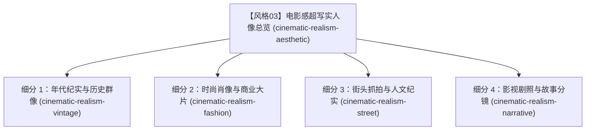

# 【风格03 · 电影感超写实人像】总览与调度中枢 (Cinematic Realism Master Skill)

本指南是**电影感超写实人像**视觉体系的总纲与调度中枢。全系列统一采用 **`cinematic-realism-*`** 前缀进行命名空间隔离。

在目前的 AIGC 生图领域，写实人像最大的败笔在于**“AI 塑料感与假面瓷肌”**（油光发亮的无瑕疵皮肤、过度对称的五官、廉价的过度锐化）。本指南通过**物理级真实光学参数、生理学皮肤微瑕疵与经典电影胶片模拟**三大核心支柱，实现令人信服的影视级真实感。

---

## 电影感超写实人像：细分场景技能索引

| 专属细分技能名称 | 规范文档路径 | 核心适用场景 | 关键视觉调性 |
| :--- | :--- | :--- | :--- |
| **`cinematic-realism-vintage`** | [.skills/cinematic-realism-vintage/SKILL.md](file:///c:/Users/33046/Desktop/short%20video/.skills/cinematic-realism-vintage/SKILL.md) | 70-80年代怀旧老照片、农村与工厂全家福、历史家庭影像 | 35mm 胶片颗粒、柯达 Portra/Tri-X 褪色感、质朴粗布衣物、真实劳动风霜 |
| **`cinematic-realism-fashion`** | [.skills/cinematic-realism-fashion/SKILL.md](file:///c:/Users/33046/Desktop/short%20video/.skills/cinematic-realism-fashion/SKILL.md) | 85mm 浅景深时尚肖像、高端杂志封面、虚拟模特试衣 | 哈苏中画幅、自然裸妆毛孔、伦勃朗柔光、细腻次表面散射 |
| **`cinematic-realism-street`** | [.skills/cinematic-realism-street/SKILL.md](file:///c:/Users/33046/Desktop/short%20video/.skills/cinematic-realism-street/SKILL.md) | 徕卡 35mm 街头抓拍、市井烟火气、纪实摄影 | 自然漫反射、抓拍不看镜头的抓人眼神、环境杂乱真实感 |
| **`cinematic-realism-narrative`** | [.skills/cinematic-realism-narrative/SKILL.md](file:///c:/Users/33046/Desktop/short%20video/.skills/cinematic-realism-narrative/SKILL.md) | 2.39:1 变形宽银幕电影剧照、戏剧悬念人物分镜 | 变形镜头光斑（Anamorphic flare）、冷暖色调对冲、沉浸式电影级景深 |

---

## 电影感超写实人像：四大底层物理铁律（全系列强制生效）

### 1. 彻底禁用“AI 塑料词”
* **坚决禁止使用**：`hyperrealistic`, `ultra-detailed`, `8k`, `photorealistic`, `perfect face`。这组词在目前主流大模型中已被污染，几乎 100% 诱发油腻假面与磨皮塑料感。
* **替换为物理光学词**：`shot on 35mm film, Kodak Portra 400, natural skin texture, visible pores, subtle peach fuzz, authentic imperfections`。

### 2. 生理学次表面散射（Subsurface Scattering, SSS）
* 人类皮肤是半透光的。光线穿透表皮时会在耳廓、鼻翼、脸颊边缘产生**微红的暖色透光泛红（Subsurface scattering glow）**。缺少次表面散射的皮肤会呈现死石膏或塑料假人质感。

### 3. 微瑕疵与随机毛糙（Organic Imperfections）
* 真人脸部必然具备微小瑕疵：非完全对称的眉毛、笑纹（Crow's feet）、细微法令纹、散落的毛糙碎发（Flyaway hairs）、晒斑与自然的肤色不均。没有瑕疵就没有真实感。

### 4. 镜头焦段与虚化逻辑
* **28mm / 35mm**：用于包含环境背景的纪实抓拍与家庭合影，透视自然，避免脸部畸变。
* **50mm**：标准人眼透视，最接近日常视觉感受。
* **85mm / 105mm**：浅景深面部特写，奶油般柔化背景（Creamy bokeh）。

---

## 细分场景调度决策树

* **问**：画面要表现 70、80 年代的老中国、农村家庭合影、胶片泛黄质感？  
  👉 **直接调用 `cinematic-realism-vintage`**
* **问**：画面是高端商业写真、模特棚拍、高清面部毛孔细节与时尚杂志风？  
  👉 **直接调用 `cinematic-realism-fashion`**
* **问**：画面发生在街头、菜市场、地铁口，抓拍真实生活中的行人神态？  
  👉 **直接调用 `cinematic-realism-street`**
* **问**：画面要有电影剧照感、变形宽银幕光斑，包含强烈的故事悬念？  
  👉 **直接调用 `cinematic-realism-narrative`**

