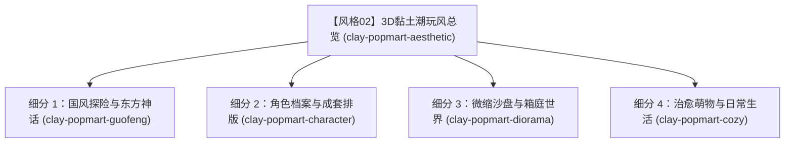

# 【风格02 · 3D黏土潮玩风】总览与调度中枢 (3D Clay Master Skill)

本指南是**3D 黏土潮玩与盲盒手办风**视觉体系的总纲与调度中枢。为了与日系吉卜力（`ghibli-fresh-*`）、新中式水墨（`guofeng-ink-*`）等风格明确区隔，全系列采用统一标识前缀 **`clay-popmart-*`**。

该风格的核心吸引力在于**“实体可触摸感”与“Q版萌系治愈感”**，将虚拟图像渲染出如同放置在展示柜中的实体潮玩手办效果。

---

## 3D 黏土潮玩风：细分场景技能索引

| 专属细分技能名称 | 规范文档路径 | 核心适用场景 | 关键视觉调性 |
| :--- | :--- | :--- | :--- |
| **`clay-popmart-guofeng`** | [.skills/clay-popmart-guofeng/SKILL.md](file:///c:/Users/33046/Desktop/short%20video/.skills/clay-popmart-guofeng/SKILL.md) | 国风山谷探险、东方神兽、仙侠道童、青铜石刻小人 | 陶土黏土、朱砂朱红、翡翠玉质、汉服Q版圆润褶皱 |
| **`clay-popmart-character`** | [.skills/clay-popmart-character/SKILL.md](file:///c:/Users/33046/Desktop/short%20video/.skills/clay-popmart-character/SKILL.md) | 盲盒手办排版、全套角色档案卡、多角度展示、包装盒立绘 | 统一展示地台、2头身比例、排版信息栏、商业打样感 |
| **`clay-popmart-diorama`** | [.skills/clay-popmart-diorama/SKILL.md](file:///c:/Users/33046/Desktop/short%20video/.skills/clay-popmart-diorama/SKILL.md) | 微缩景观沙盘、黏土浮岛、立体书式场景、探险生态箱庭 | 移轴微距摄影、浅景深、黏土捏制的花草岩石与树木 |
| **`clay-popmart-cozy`** | [.skills/clay-popmart-cozy/SKILL.md](file:///c:/Users/33046/Desktop/short%20video/.skills/clay-popmart-cozy/SKILL.md) | 胖嘟嘟动物、甜品美食拟人、解压小物件、生活杂物盲盒 | 柔软饱满形态、马卡龙温和粉彩、细腻哑光亲肤感 |

---

## 3D 黏土潮玩风：四大底层质感法则（全系列通用）

无论生成哪一种细分场景，必须严格控制以下材质与光影要素，防止画面退化为劣质塑料 3D：

1. **软陶肌理与手作微瑕疵（Polymer Clay & Thumbprints）**：
   * 画面表面必须具备软陶（Polymer clay）或轻黏土（Plasticine）的物理特征，允许出现极细微的手工捏塑压痕（Tooling marks）与指纹微痕（Subtle thumbprints），正是这种瑕疵感彻底消除了传统 AI 的“工业塑料味”。
2. **“哑光本体 + 局部高光树脂”的光学对比**：
   * 角色皮肤、衣物主体呈现柔和吸光的**哑光磨砂质感（Matte finish）**。
   * 眼睛、鼻尖或饰品小水滴则采用**高光透明树脂/陶瓷釉面（Glossy resin glaze）**，形成强烈的材质层次反差。
3. **商业摄影级柔光箱布光（Studio Softbox Lighting）**：
   * 采用经典三点布光：顶部柔光箱产生大面积柔和漫反射、侧向微弱辅光填充阴影、背部轻微轮廓光（Rim light）分离背景，严禁使用刺眼的生硬直射光。
4. **极致可爱的头身比（Chibi Proportions）**：
   * 严格遵循 2 头身至 2.5 头身比例，圆润大头、短圆小手小脚、弧形下巴，避免任何锐利危险的尖角。

---

## 细分场景调度决策树

* **问**：需求带有中国古典元素、古代山谷、玉佩石刻或神话小神兽？  
  👉 **直接调用 `clay-popmart-guofeng`**
* **问**：需求是多角色同屏档案、成套盲盒手办展示、带有海报排版与世界观介绍？  
  👉 **直接调用 `clay-popmart-character`**
* **问**：需求是黏土搭建的小人国场景、微缩山谷生态或立体箱庭沙盘？  
  👉 **直接调用 `clay-popmart-diorama`**
* **问**：需求是单个萌物、小动物、蛋糕甜点或日常治愈系头像？  
  👉 **直接调用 `clay-popmart-cozy`**
