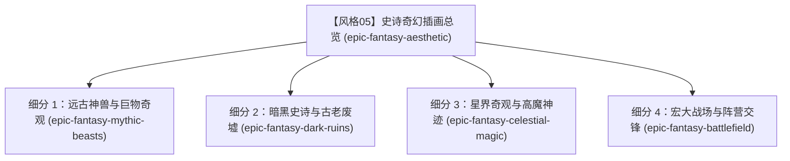

# 【风格05 · 史诗奇幻插画】总览与调度中枢 (Epic Fantasy Master Skill)

本指南是**史诗奇幻概念插画**视觉体系的总纲与调度中枢。全系列统一采用 **`epic-fantasy-*`** 前缀进行命名空间隔离。

史诗奇幻（Epic Fantasy / Dark Fantasy / Concept Art）受《艾尔登法环》《魔兽世界》《万智牌》以及经典油画大师（Frank Frazetta, Greg Rutkowski）影响深远，其核心灵魂在于**“超越人眼日常尺度的崇高感（The Sublime）”**。

---

## 史诗奇幻插画：细分场景技能索引

| 专属细分技能名称 | 规范文档路径 | 核心适用场景 | 关键视觉调性 |
| :--- | :--- | :--- | :--- |
| **`epic-fantasy-mythic-beasts`** | [.skills/epic-fantasy-mythic-beasts/SKILL.md](file:///c:/Users/33046/Desktop/short%20video/.skills/epic-fantasy-mythic-beasts/SKILL.md) | 大鹏/鲲鹏展翅、巨龙翱翔、深海利维坦、泰坦神兽 | 遮天蔽日的体量对比、滔天海浪与风暴云霄、磅礴张力 |
| **`epic-fantasy-dark-ruins`** | [.skills/epic-fantasy-dark-ruins/SKILL.md](file:///c:/Users/33046/Desktop/short%20video/.skills/epic-fantasy-dark-ruins/SKILL.md) | 破碎哥特巨石圣殿、暗黑城堡、残阳落日、苍茫死寂 | 冷峻厚涂油画笔触、斑驳侵蚀石面、黄金微光与浓雾 |
| **`epic-fantasy-celestial-magic`** | [.skills/epic-fantasy-celestial-magic/SKILL.md](file:///c:/Users/33046/Desktop/short%20video/.skills/epic-fantasy-celestial-magic/SKILL.md) | 浮空岛屿瀑布、星云旋涡、极光魔力流、神明降临 | 超现实高饱和奇观、发光生态、天界辉光与宇宙裂隙 |
| **`epic-fantasy-battlefield`** | [.skills/epic-fantasy-battlefield/SKILL.md](file:///c:/Users/33046/Desktop/short%20video/.skills/epic-fantasy-battlefield/SKILL.md) | 千军万马对峙、烽烟战旗、暴风雨阵营冲锋、攻城巨兽 | 强透视低角度镜头、动态速度线、飞溅泥浆与火星尘土 |

---

## 史诗奇幻插画：四大底层视觉铁律（全系列强制生效）

### 1. 极致体量感与比例尺参照（Scale Anchoring）
* 画巨物、古迹或宏大自然时，必须在画面边缘或前景放置**渺小的参照物**（如一叶孤舟、单骑骑士剪影、展翅的海鸥群），通过数千倍的尺度悬殊，直接激发“巨物恐惧与震撼”。

### 2. 电影级体积光与大气烟尘（Volumetric God Rays & Atmospheric Haze）
* 光线不是平涂的，必须穿透云层缝隙、海水飞沫或废墟残垣，形成肉眼可见的**丁达尔光束（God rays）**。空气中浮动着细碎的灰烬、发光孢子或雨丝水雾。

### 3. 厚涂油画与数字绘景质感（Digital Matte Painting Texture）
* 避免廉价的扁平 2D 或光滑的塑料 3D，通过引入 `textured impasto oil brushstrokes, dynamic matte painting, ArtStation trending`，让画面每一处岩石肌理和羽毛鳞片都充满手工雕琢的厚重感。

### 4. 强烈的戏剧性冷暖对冲（Dramatic Chiaroscuro）
* 阴影部偏向冷郁的深海蓝、玄武岩深灰或冷紫，受光面则被暖金落日、闪电青白或炽热熔岩点亮，在极端对比中强化命运感与史诗感。

---

## 细分场景调度决策树

* **问**：画面核心是神兽展翅、巨兽破海、鲲鹏扶摇直上九万里的狂风巨浪？  
  👉 **直接调用 `epic-fantasy-mythic-beasts`**
* **问**：画面核心是幽暗城堡、破碎神殿、苍凉残阳下的孤独探索者？  
  👉 **直接调用 `epic-fantasy-dark-ruins`**
* **问**：画面核心是绚烂的浮空岛、星界魔法流、发光神域与天界奇观？  
  👉 **直接调用 `epic-fantasy-celestial-magic`**
* **问**：画面核心是千军冲锋、战旗猎猎、铁血要塞攻防战？  
  👉 **直接调用 `epic-fantasy-battlefield`**

