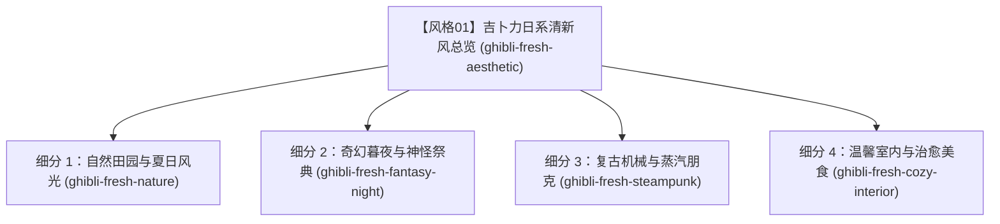

# 【风格01 · 吉卜力日系清新风】总览与调度中枢 (Ghibli Master Skill)

本指南是**吉卜力日系清新风**视觉体系的总纲与调度中枢。为了与后续其他热门风格（如 3D 黏土、新中式水墨、赛博朋克等）形成清晰的命名空间隔离，本风格全系列采用统一标识前缀 **`ghibli-fresh-*`**。

---

## 吉卜力日系清新风：细分场景技能索引

| 专属细分技能名称 | 规范文档路径 | 代表作品与意象 | 核心适用场景 | 关键视觉调性 |
| :--- | :--- | :--- | :--- | :--- |
| **`ghibli-fresh-nature`** | [.skills/ghibli-fresh-nature/SKILL.md](file:///c:/Users/33046/Desktop/short%20video/.skills/ghibli-fresh-nature/SKILL.md) | 《龙猫》《岁月的童话》《侧耳倾听》 | 夏日稻浪、乡间里山、巨型积雨云、森林古树 | 男鹿和雄水粉厚涂、翡翠绿、天青蓝、木漏れ日（Komorebi） |
| **`ghibli-fresh-fantasy-night`** | [.skills/ghibli-fresh-fantasy-night/SKILL.md](file:///c:/Users/33046/Desktop/short%20video/.skills/ghibli-fresh-fantasy-night/SKILL.md) | 《千与千寻》《哈尔》星空湖、《幽灵公主》荧光山神 | 水上油屋、红灯笼暮市、水上列车、神怪妖灵 | 深靛蓝夜空、纸灯笼琥珀暖光、水雾与水面反光 |
| **`ghibli-fresh-steampunk`** | [.skills/ghibli-fresh-steampunk/SKILL.md](file:///c:/Users/33046/Desktop/short%20video/.skills/ghibli-fresh-steampunk/SKILL.md) | 《天空之城》《红猪》《风之谷》《起风了》 | 蒸汽飞艇、扑翼机、移动城堡、云上遗迹、采矿小镇 | 黄铜铆钉、铸铁齿轮、膨胀白蒸汽、手绘工程图感 |
| **`ghibli-fresh-cozy-interior`** | [.skills/ghibli-fresh-cozy-interior/SKILL.md](file:///c:/Users/33046/Desktop/short%20video/.skills/ghibli-fresh-cozy-interior/SKILL.md) | 《魔女宅急便》《借物少女艾莉缇》《哈尔》厨房 | 煎培根太阳蛋、杂乱温馨木屋、手作杂货、烘焙面包 | 升腾半透明热汽、蜜蜡暖光、原木餐具、微尘光柱 |

---

## 吉卜力日系清新风：全系列通用美学铁律

无论调用哪一个细分场景，以下四大铁律均强制生效，确保风格纯正：

1. **彻底拒绝 3D 塑料感**：提示词强制注入 `traditional 2D hand-drawn cel animation`，负向词压制 `3D render, CGI, glossy plastic, photorealistic`。
2. **拒绝死黑与死白**：阴影使用冷青灰、深靛蓝或暗褐色过渡；高光使用暖金、米白或淡柠檬黄，坚决不用数码纯白。
3. **保留纸张与水粉干笔触肌理**：通过 `gouache background painting texture`、`watercolor wash`、`rough paper grain`，从底层杜绝 AI 平滑感。
4. **情感温度大于机械冷峻**：线条圆润憨厚，带着手工弧度与生活温度，杜绝冷冰冰的未来主义与锋利几何角。

---

## 细分场景调度选择依据

* **问**：画面发生在白天，核心是阳光、微风、植物、广阔的乡村与大自然？  
  👉 **直接调用 `ghibli-fresh-nature`**
* **问**：画面发生在黄昏或夜晚，有红灯笼、神秘生物、水面反光与温泉水汽？  
  👉 **直接调用 `ghibli-fresh-fantasy-night`**
* **问**：画面以飞艇、扑翼机、齿轮机械、飞行员与云海探险为主？  
  👉 **直接调用 `ghibli-fresh-steampunk`**
* **问**：画面发生在室内，有热腾腾的煎蛋培根、面包咖啡，或者充满生活杂物的书房？  
  👉 **直接调用 `ghibli-fresh-cozy-interior`**
