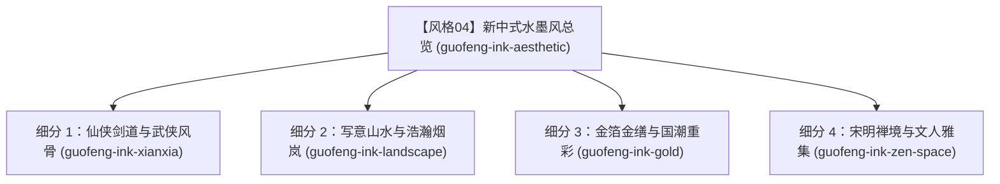

# 【风格04 · 新中式水墨风】总览与调度中枢 (Guofeng Ink Master Skill)

本指南是**新中式水墨风**视觉体系的总纲与调度中枢。全系列统一采用 **`guofeng-ink-*`** 前缀进行命名空间隔离。

传统水墨讲究“气韵生动、以形写神”，而新中式水墨在此基础上融合了**现代通透光影、张力十足的书法笔势动效与金属质感点缀（如金箔、金缮、朱砂）**。它既保留了东方独有的空灵留白，又具备现代视觉的强烈冲击力。

---

## 新中式水墨风：细分场景技能索引

| 专属细分技能名称 | 规范文档路径 | 核心适用场景 | 关键视觉调性 |
| :--- | :--- | :--- | :--- |
| **`guofeng-ink-xianxia`** | [.skills/guofeng-ink-xianxia/SKILL.md](file:///c:/Users/33046/Desktop/short%20video/.skills/guofeng-ink-xianxia/SKILL.md) | 剑仙李白、武侠打斗、水上竹林、御剑飞天、狂草剑气 | 白衣胜雪、狂草笔势流光、泼墨剑意、水雾腾起、竹影潇洒 |
| **`guofeng-ink-landscape`** | [.skills/guofeng-ink-landscape/SKILL.md](file:///c:/Users/33046/Desktop/short%20video/.skills/guofeng-ink-landscape/SKILL.md) | 泼墨黄山、云海孤舟、悬崖古松、深潭瀑布、宏大山水 | 墨分五色、淡墨轻岚、浓墨奇峰、极致计白当黑 |
| **`guofeng-ink-gold`** | [.skills/guofeng-ink-gold/SKILL.md](file:///c:/Users/33046/Desktop/short%20video/.skills/guofeng-ink-gold/SKILL.md) | 黑金水墨、金缮裂纹、朱砂印章、文创高定包装 | 焦墨与真金箔（Gold Leaf）强烈碰撞、朱砂赤红点睛 |
| **`guofeng-ink-zen-space`** | [.skills/guofeng-ink-zen-space/SKILL.md](file:///c:/Users/33046/Desktop/short%20video/.skills/guofeng-ink-zen-space/SKILL.md) | 宋代极简、茶道空间、枯木竹影隔栅、古琴案几 | 柔和侧光、光影斑驳、素雅灰褐、宁静克制的禅宗美学 |

---

## 新中式水墨风：四大底层艺术铁律（全系列强制生效）

### 1. 墨分五色与笔触干湿（Ink Dynamics & Feibai）
* 画面必须具备丰富的墨色层次：**焦、浓、重、淡、清**。
* 动态处展现**枯笔飞白（Dry brush / Feibai）**，静止处展现**生宣纸水墨扩散晕染（Ink bleed on absorbent Xuan paper）**。严禁画成生硬均质的黑色电脑涂色。

### 2. 计白当黑（Negative Space / Liubai）
* 留白不是空无一物，而是烟波、云气、空间与宇宙虚无的延伸。画面必须留出至少 **30%-50%** 的呼吸空间，避免构图死板拥堵。

### 3. 严格防范“日式浮世绘”跑偏（Anti-Ukiyo-e Guardrail）
* AI 在理解东方水墨时，极容易误加入日本浮世绘波浪纹、和风家纹或和纸折痕。
* 负向词必须强制加入：`ukiyo-e, Japanese style, kimono, Hokusai wave`，确保纯正的华夏风骨与文人意境。

### 4. 局部点睛与光影通透
* 在以黑白灰为主的水墨基调中，仅允许极少数**高对比东方传统色彩点睛**（如朱砂红 Cinnabar、金箔 Gold leaf、翠竹绿 Jade green），辅以通透的丁达尔圣光（God rays）打破沉闷。

---

## 细分场景调度决策树

* **问**：画面要表现剑客、仙人、李白拔剑起舞、气劲凌厉的动作张力？  
  👉 **直接调用 `guofeng-ink-xianxia`**
* **问**：画面以纯自然山水、云海、孤舟蓑笠翁的大气意境为主？  
  👉 **直接调用 `guofeng-ink-landscape`**
* **问**：画面需要奢华高端、黑金碰撞、金缮描金或商用包装海报？  
  👉 **直接调用 `guofeng-ink-gold`**
* **问**：画面以室内茶室、窗棂竹影、古琴焚香等幽静意境为主？  
  👉 **直接调用 `guofeng-ink-zen-space`**

