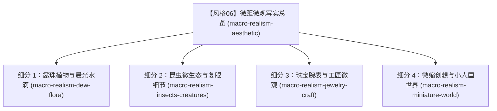

# 【风格06 · 微距微观写实】总览与调度中枢 (Macro Realism Master Skill)

本指南是**微距微观写实摄影**视觉体系的总纲与调度中枢。全系列统一采用 **`macro-realism-*`** 前缀进行命名空间隔离。

微距摄影的核心魅力在于**“揭示人眼盲区的微观奇迹”**。在 1:1 甚至 5:1 的微观放大率下，平时微不足道的一颗晨露、一片草叶的绒毛或一只昆虫的复眼，都会呈现出令人屏息的宇宙级秩序感。

---

## 微距微观写实：细分场景技能索引

| 专属细分技能名称 | 规范文档路径 | 核心适用场景 | 关键视觉调性 |
| :--- | :--- | :--- | :--- |
| **`macro-realism-dew-flora`** | [.skills/macro-realism-dew-flora/SKILL.md](file:///c:/Users/33046/Desktop/short%20video/.skills/macro-realism-dew-flora/SKILL.md) | 清晨露珠、叶脉水滴、倒映微观世界、起雾晨光 | 水滴凸透镜折射倒影、表面张力、植物腺毛（Trichomes）、晨雾奶油光斑 |
| **`macro-realism-insects-creatures`** | [.skills/macro-realism-insects-creatures/SKILL.md](file:///c:/Users/33046/Desktop/short%20video/.skills/macro-realism-insects-creatures/SKILL.md) | 跳蛛复眼、蜻蜓晶莹翅脉、带水滴蛛网、甲虫彩虹光泽 | 国家地理科学微距、六角小眼复眼阵列、外骨骼甲壳水渍 |
| **`macro-realism-jewelry-craft`** | [.skills/macro-realism-jewelry-craft/SKILL.md](file:///c:/Users/33046/Desktop/short%20video/.skills/macro-realism-jewelry-craft/SKILL.md) | 机械腕表擒纵齿轮咬合、红宝石轴承、钻石刻面火彩 | 极高精度金属拉丝切面、高反光宝石折射、精密装配微距 |
| **`macro-realism-miniature-world`** | [.skills/macro-realism-miniature-world/SKILL.md](file:///c:/Users/33046/Desktop/short%20video/.skills/macro-realism-miniature-world/SKILL.md) | 田中达也式小人国、火柴/落叶微缩场景、趣味视觉错觉 | 移轴微距透视、日常用品当宏观地貌、温情叙事小剧场 |

---

## 微距微观写实：四大底层光学铁律（全系列强制生效）

### 1. 物理级极薄焦平面（Razor-Thin Focal Plane）
* 微距摄影的景深极浅（Depth of field），有效清晰范围往往只有 1-2 毫米。
* 必须指定精确的对焦点（如 `sharp focus on the center water droplet rim`），而让前景与背景化为极其梦幻柔滑的**奶油虚化（Creamy circular bokeh）**。

### 2. 水滴的天然凸透镜折射物理（Optical Refraction & Caustics）
* 水珠不是死灰的圆点，由于表面张力（Surface tension）呈完美饱满的球弧状。
* 关键物理特征：水滴内部必须**折射并倒映出微缩颠倒的外部世界（Inverted miniature reflection/landscape）**，并在受光面形成针尖般耀眼的白色高光点。

### 3. 微观次表面透光与植物微绒毛（Trichomes & Veins）
* 叶片在逆光下呈现透明的翡翠绿，清晰显现半透明导管叶脉与叶缘微小绒毛（Fine peach-fuzz trichomes）。绒毛往往拦截住微型雾珠，形成繁星般的光点。

### 4. 晨光漫射与晨雾空气透视（Morning Mist & Soft Light）
* 避免生硬正午直射光。采用清晨柔和侧逆光（Soft morning backlight），薄雾弱化了背景杂乱干扰，让光斑如同晨露般晶莹发亮。

---

## 细分场景调度决策树

* **问**：画面核心是清晨草叶上的水滴、折射微观倒影、晨曦薄雾？  
  👉 **直接调用 `macro-realism-dew-flora`**
* **问**：画面核心是昆虫复眼、蜘蛛网露珠、微观生物甲壳毛刷？  
  👉 **直接调用 `macro-realism-insects-creatures`**
* **问**：画面核心是机械手表齿轮运转、珠宝切面、金属微雕？  
  👉 **直接调用 `macro-realism-jewelry-craft`**
* **问**：画面核心是小人偶在水果、纽扣、树叶上的微缩探险？  
  👉 **直接调用 `macro-realism-miniature-world`**

