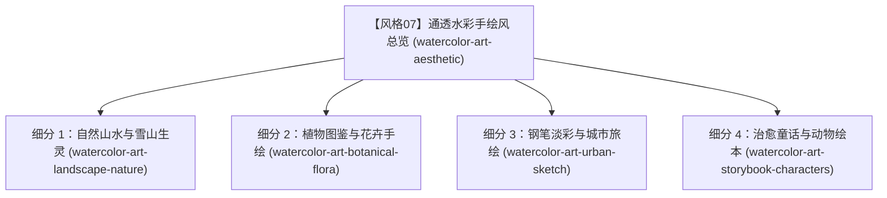

# 【风格07 · 通透水彩手绘风】总览与调度中枢 (Watercolor Art Master Skill)

本指南是**通透水彩手绘风**视觉体系的总纲与调度中枢。全系列统一采用 **`watercolor-art-*`** 前缀进行命名空间隔离。

水彩画（Watercolor）的核心魅力在于**“不可控的意外美感与透明呼吸感”**——颜料在湿润棉纸上的无拘无束扩散、水渍边缘的微妙沉降，以及利用纯白纸张作为最高光源的半透明叠色法。

---

## 通透水彩手绘风：细分场景技能索引

| 专属细分技能名称 | 规范文档路径 | 核心适用场景 | 关键视觉调性 |
| :--- | :--- | :--- | :--- |
| **`watercolor-art-landscape-nature`** | [.skills/watercolor-art-landscape-nature/SKILL.md](file:///c:/Users/33046/Desktop/short%20video/.skills/watercolor-art-landscape-nature/SKILL.md) | 湖面雪山倒影、野生动物（鹿/鹤/狐狸）、冰川高原自然 | 湿画法大面积水晕、冷压粗纹纸肌理、高山湖泊倒影、空灵透气 |
| **`watercolor-art-botanical-flora`** | [.skills/watercolor-art-botanical-flora/SKILL.md](file:///c:/Users/33046/Desktop/short%20video/.skills/watercolor-art-botanical-flora/SKILL.md) | 欧洲古典植物图鉴、水彩花卉、草药图解、文创明信片 | 叠色透明感（Glazing）、细腻花瓣叶脉线描、白底标本式雅致 |
| **`watercolor-art-urban-sketch`** | [.skills/watercolor-art-urban-sketch/SKILL.md](file:///c:/Users/33046/Desktop/short%20video/.skills/watercolor-art-urban-sketch/SKILL.md) | 钢笔淡彩（Line & Wash）、欧洲街景、咖啡馆外廊、旅行手账 | 随性防水钢笔勾线、局部随意泼彩、留白飞白、浓郁市井文艺感 |
| **`watercolor-art-storybook-characters`** | [.skills/watercolor-art-storybook-characters/SKILL.md](file:///c:/Users/33046/Desktop/short%20video/.skills/watercolor-art-storybook-characters/SKILL.md) | 比得兔式经典儿童绘本、拟人小动物、治愈童话故事 | 柔和粉彩调、圆润手绘外轮廓、怀旧绘本温暖笔触 |

---

## 通透水彩手绘风：四大底层物理铁律（全系列强制生效）

### 1. 湿画法水痕与边缘沉降（Wet-on-Wet & Pigment Blooms）
* 画面必须具备真实物理流动痕迹：**湿画法色彩柔化渐变（Soft color bleeds）**，以及水滴干燥后留下的**自然水痕边缘（Organic water blooms / Cauliflower edges）**。严禁均质的数码渐变（Digital gradients）。

### 2. 矿物颜料颗粒沉降（Pigment Granulation）
* 高品质专业级水彩（如群青 Ultramarine、生赭 Raw Sienna）在粗纹纸凹陷处会沉淀出微细的**颗粒斑驳质感（Textured pigment separation）**，赋予画面手工矿物颜料的厚重呼吸感。

### 3. 冷压纯棉粗纹水彩纸（Cold-Pressed Cotton Paper Tooth）
* 底层必须隐约可见 **300g 纯棉水彩纸的凹凸纸齿纹理（Visible paper tooth & texture）**与粗糙毛边，彻底消除数码屏幕的冷光平滑感。

### 4. 留白而非覆盖（Preserved Paper White）
* 传统水彩画中**绝不使用白色涂料覆盖**。高光部位（如雪峰反光、水面波光、动物眼周）均来自**对白纸本身的留白（Negative paper white）**，从而保持通透的光学纯度。

---

## 细分场景调度决策树

* **问**：画面要表现高山湖泊、倒映雪山、野生动物驻足的空灵自然？  
  👉 **直接调用 `watercolor-art-landscape-nature`**
* **问**：画面以单个花卉、多肉植物、草本植物的精细手绘图鉴为主？  
  👉 **直接调用 `watercolor-art-botanical-flora`**
* **问**：画面带有明显的钢笔勾线线条、欧洲老街咖啡馆或旅行写生速写？  
  👉 **直接调用 `watercolor-art-urban-sketch`**
* **问**：画面是儿童绘本里的拟人小兔子、小熊等温馨童话故事？  
  👉 **直接调用 `watercolor-art-storybook-characters`**

