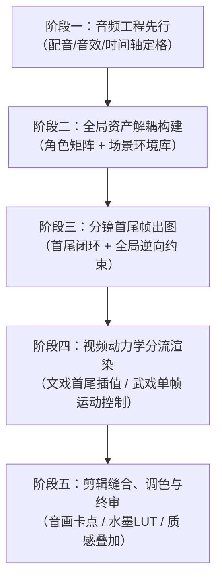

# AIGC 国风剧情短片与游戏 CG 工业级制作标准作业程序（SOP）

> **适用场景**：高要求角色一致性剧情短片、游戏宣发 CG、高燃武侠/玄幻动作叙事、商业级视听混剪。  
> **核心目标**：彻底解决“角色跳脸、动作失控融化、场景画风割裂”三大核心工业痛点。  
> **核心原则**：先声后画、资产解耦、首尾锚定、分流渲染。

---

## 一、生产管线总体拓扑图



---

## 二、阶段一：音频工程先行（先声后画）

在任何绘图与视频生成前，必须先行完成音频轨道锁定。严禁“先做视频再配音配乐”，否则后续将面临大量剪辑硬拖、跳帧与口型动作脱节。

### 1.1 执行步骤
1. **录制/生成干音配音**：
   - 确定情绪起伏梯度：低沉压抑（00:00-00:35） $\rightarrow$ 紧凑交锋（00:35-01:15） $\rightarrow$ 极静留白（01:15-01:40） $\rightarrow$ 高燃爆发（01:40-02:10） $\rightarrow$ 超然释怀（02:10-02:30）。
   - 保留充足的呼吸声与换气留白（戏剧性停顿至少留出 1.5s - 3s）。
2. **铺设音效与配乐草稿轨（BGM & SFX Bed）**：
   - 标记出全片关键重音点（如：残卷入水水滴声、拔剑龙吟、太行破冰声、唢呐高潮进场点）。
3. **输出《分镜头秒数定格表》（精确至毫秒）**：
   - 每个分镜切片时长必须控制在视频生成模型的最佳工作区间：**2.5秒 至 4.0秒**。

---

## 三、阶段二：全局资产解耦构建

将“角色、场景、道具”三者彻底分离独立建档，杜绝单次提示词混合渲染带来的随机污染。

### 2.1 角色定装矩阵表（Character Reference Sheet）
生成并固定全局唯一的“角色定装包”（以李白·诗剑行等核心主角为例，输出 4 张 4K 级别基准底图）：

| 资产编号 | 资产类型 | 构图规范 | 核心约束要素 |
| :--- | :--- | :--- | :--- |
| `CHR-01` | **正面全身立绘** | 站姿、纯平视、大景深 | 月白交领长袍、衣摆水墨渐变、腰封绑带、整体比例 |
| `CHR-02` | **三侧身/背影图** | 45度角与背向侧面 | 墨黑长发马尾弧度、后背衣摆大面积写意泼墨飞白肌理 |
| `CHR-03` | **面部微距特写** | 视线斜视、微表情自然 | 剑眉星目、俊朗下颌线、发丝垂落位置、冷冽神情 |
| `CHR-04` | **核心道具特写** | 道具孤立静物特写 | 三尺青锋（冷青刃口）、李花黑鞘（带露花枝）、白玉酒壶 |

### 2.2 场景独立环境库（Environment Reference Library）
提前渲染并锁定无角色的纯环境图，用于视频背景垫图或 ControlNet 空间约束：
- `SCN-01（暴雨绝壁）`：冷灰黑云、千仞峭壁、折断青竹、雨幕横江。
- `SCN-02（深潭水墨世界）`：纯黑背景、幽微水光、水下扩散浓墨。
- `SCN-03（冰塞雪岭）`：冻结玄冰、漫天飞雪、苍茫远山。
- `SCN-04（万顷竹海晨光）`：压弯墨竹、晨雾水泊、轻舟微浪。

---

## 四、阶段三：分镜关键帧生产（首帧与尾帧锚定）

### 3.1 首尾帧位移阈值控制法则（Anti-Morphing Rules）
为防止视频模型在插值生成时产生“肢体融化、多剑、脸型突变”：
- **动作角度差限制**：单个分镜中，首帧与尾帧的角度差严禁超过 **45度**（例如：不得从正面平视直接接倒挂俯冲）。
- **空间景别连续性**：镜头不得跨级跳切（如：首帧大特写 $\rightarrow$ 尾帧大全景），同一镜头内仅允许一次常规平滑推/拉/摇/移。

### 3.2 提示词标准化结构
```text
[分镜首尾状态指令: Start Frame / End Frame] + 
[全局角色锚定: @CHR-01, Handsome young swordsman in moon-white ink-robes] + 
[具体动作与受力: Unsheathing sword, body leaning back in aerial jump] + 
[对应环境底图: @SCN-04, In dense ink bamboo sea with swirling wind] + 
[光影与镜头运动: Pan right, dynamic cinematic rim lighting] + 
[全局画风约束: Neo-Chinese ink wash painting fused with 3D CG, Octane render]
```

### 3.3 全局逆向约束词池（Negative Prompt Pool）
```text
western armor, european face, neon saturation, high contrast rainbow, plastic skin, cheap 3d cartoon, blurry eyes, morphed fingers, extra arms, double swords, text watermark, modern street, abrupt camera cut.
```

---

## 五、阶段四：视频动力学分流渲染

依据镜头类型，分流采用不同的 AI 视频动力学策略：

```
                    ┌── 静态/缓动镜头（推拉摇移、神情微变） ──> 【首尾帧插值法（First-Last Frame）】
分镜类型判断 ──┤
                    └── 高速动作/剑气斩击（出剑、腾空、大招） ──> 【首帧 + 运动向量提示词（First Frame + Motion Vector）】
```

### 4.1 方案 A：首尾帧插值法（针对平缓/意境镜头）
* **适用镜头**：00:00 雨中伫立、01:25 闭目凝神、02:15 踏舟远行。
* **参数设置**：
  * 输入：上传首帧图片与尾帧图片。
  * Motion/Camera 参数：中低档（Motion Strength 3-4），镜头平滑推进。
  * 提示词侧重：描述微动态（`Wind gently blowing hair, rain droplets falling from sword edge, smooth slow dolly in`）。

### 4.2 方案 B：首帧 + 运动向量法（针对高燃武戏打斗）
* **适用镜头**：00:55 水面交锋、01:45 踏冰破空、01:55 狂草剑龙斩击。
* **参数设置**：
  * 输入：仅上传该动作起势的【首帧图】。
  * Motion Strength：调高至 6-8。
  * 提示词侧重：物理动词与速度感（`Explosive upward leap, sweeping horizontal sword slash, ink dragon bursting into the sky, fast cinematic whip pan`）。

### 4.3 瑕疵帧修复处理（Inpainting）
- 若视频生成后出现手部多指或面部微崩：
  - 导出损坏帧（PNG序列），使用生图模型局部重绘修脸/修手；
  - 重新导入剪辑软件进行 2-3 帧切片替换（Cutaway 蒙太奇处理）。

---

## 六、阶段五：剪辑缝合、调色与质感叠加

### 5.1 剪辑轴心规则
1. **动作惯性匹配（Match Cut）**：上一个镜头角色向右拔剑，下一个接续镜头必须保持向右发力惯性，严禁左右违背 180 度轴线轴心法则。
2. **音画重音错位对剪（L/J Cut）**：重音音效（如剑鸣爆裂）提前 3-5 帧切入，先听其声、再见其形，增加视听张力。

### 5.2 全局调色与画质沉淀（Color Grading & Finishing）
1. **全局水墨 LUT 挂载**：
   - 压低高光饱和度，提拉黑色阶曲线（增加墨色沉底感），将阴影色相微调偏冷（冷灰青），高光微泛暖（象牙宣纸微黄）。
2. **动态贴层（Atmospheric Overlays）**：
   - 叠加 5%-8% 透明度的**水墨飞溅与粉尘噪点粒子**（Ink splash & dust overlay）；
   - 镜头高光处添加微弱变形宽银幕光晕（Anamorphic streak），消解纯 AI 生成的平滑塑料感。

---

## 七、实战分镜执行参考表（以《诗剑行》为例）

| 镜头号 | 时长 | 景别 & 运镜 | 画面内容（动作与意境） | 资产调用 | 渲染方案 | 对应台词/音效 |
| :---: | :---: | :---: | :---: | :---: | :---: | :---: |
| **SC-01** | 3.5s | 远景 $\rightarrow$ 中景缓慢推进 | 黑云压顶断崖，暴雨如注，剑客手按剑鞘背身伫立 | `CHR-02`<br>`SCN-01` | 首尾帧插值 | 凄厉风雨声<br>“世人皆言，仗剑江湖…” |
| **SC-02** | 3.0s | 特写微仰 | 墨发飞舞，雨水顺着剑刃滑落，眼神冷峻坚毅 | `CHR-03`<br>`CHR-04` | 首尾帧插值 | 箫声低咽<br>“…却无人知晓何处是剑道彼岸” |
| **SC-03** | 2.5s | 中景侧身快速下摇 | 剑客手松，残卷落入深潭，水面瞬间炸开漫天墨迹 | `CHR-01`<br>`SCN-02` | 首帧+运动向量 | 沉闷水滴入潭轰鸣声 |
| **SC-04** | 3.5s | 全景高速横移 | 水面虚空，白衣与潭底黑影凌空交锋，墨浪滔天 | `CHR-01`<br>`SCN-02` | 首帧+运动向量 | 密集剑鸣打斗音效<br>“欲渡黄河冰塞川…” |
| **SC-05** | 2.0s | 特写正前定格（子弹时间） | 风雪定格半空，剑客闭目凝神，手中残卷化金光消散 | `CHR-03` | 首尾帧插值 | 音效骤停、绝对留白<br>“世间多纷扰，岂非不知…” |
| **SC-06** | 3.0s | 大全景 360 度回旋仰拍 | 猛然睁眼，凌空踏竹破风，斩出百丈狂草金墨巨龙 | `CHR-01`<br>`SCN-04` | 首帧+运动向量 | 唢呐交响爆发、天崩地裂<br>“皆为！剑意！！！” |
| **SC-07** | 3.5s | 远景水面平移拉远 | 天地复归清明，轻舟泛于竹海平湖，白衣反手收剑入鞘 | `CHR-01`<br>`SCN-04` | 首尾帧插值 | 悠扬竹笛余音<br>“但承青莲有侠志，莫道红尘无剑仙” |

