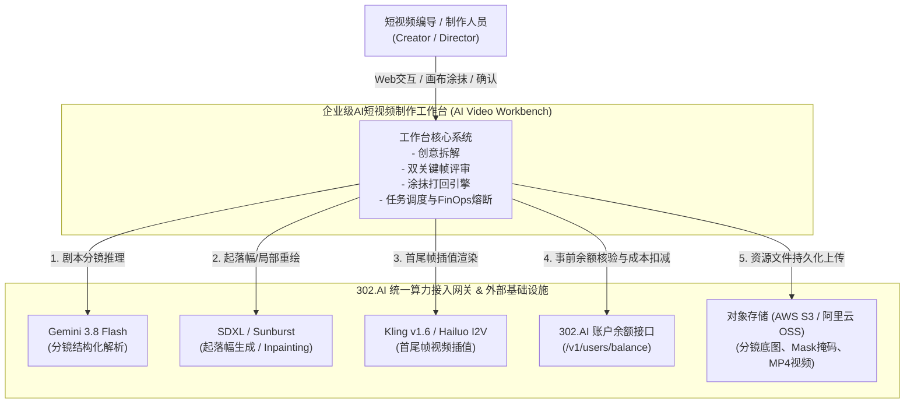
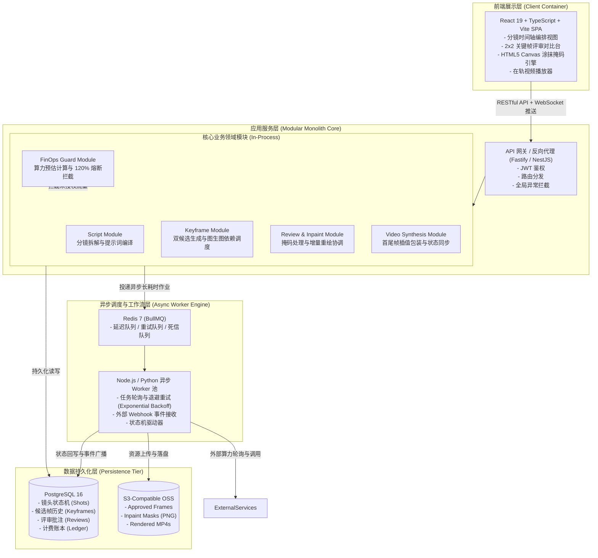
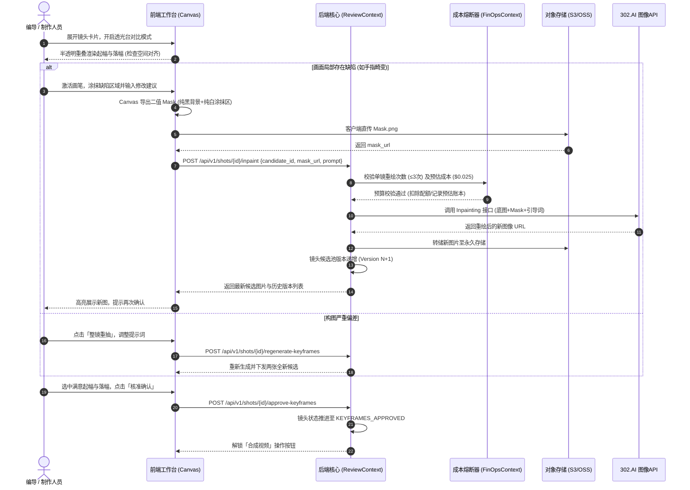
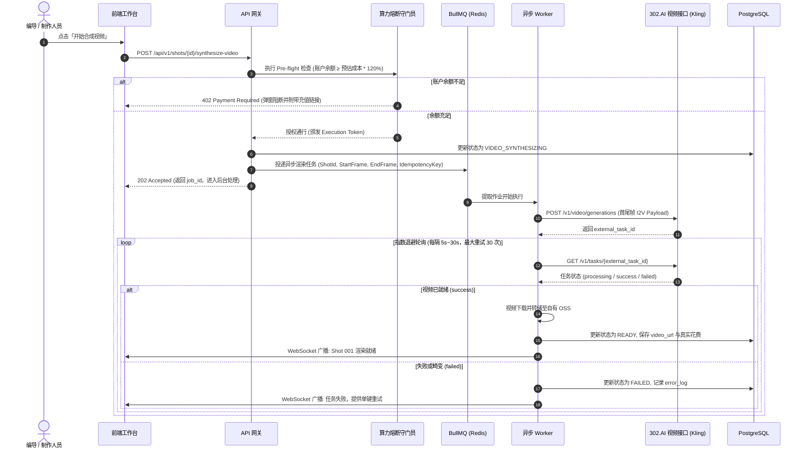
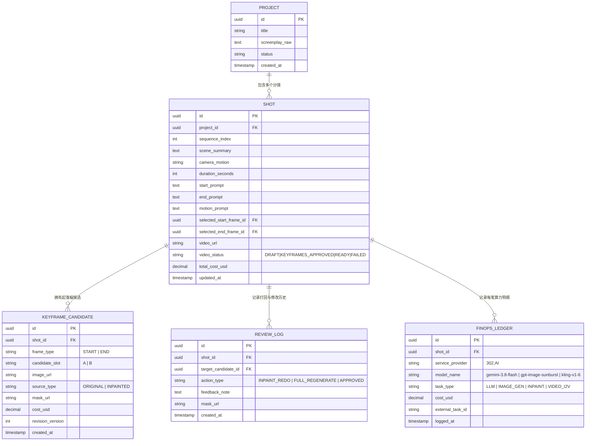

# 企业级AI短视频制作工作台（Phase 1 MVP）系统架构设计说明书

- **文档标识**：ARCH-VIDEO-MVP-001
- **标准规范**：PETL Principal Software Architect Standard (AWS Well-Architected & Google SRE 严选体系)
- **状态**：`DECIDED` (Phase 1 实施基准)
- **主架构师**：Software Architecture Working Group
- **对齐文档**：[AI短视频制作工作台_第一阶段PRD.md](file:///c:/Users/33046/Desktop/short%20video/AI短视频制作工作台_第一阶段PRD.md)
- **核心目标**：构建单镜头成本低于 $0.35、废片率低于 5%、具备事前算力熔断与首尾帧插值约束的工业级短视频生产底座。

---

## 1. 架构目标、约束与权衡框架 (Trade-off & Constraints)

### 1.1 业务核心指标与技术目标
| 业务指标 | 目标阈值 | 技术映射指标 (Quality Attribute) | 架构应对策略 |
| :--- | :--- | :--- | :--- |
| **单镜废片率** | $\le 5\%$ | 视频生成有效交付率 $\ge 95\%$ | 首尾帧空间强锁定 (I2V)，阻断直接文生视频（T2V）的自由漂移 |
| **单镜综合成本** | $\le \$0.35$ | 单镜算力消耗 P95 $\le \$0.32$ | 极轻量 LLM 结构化拆解 + 720P Standard 插值 + 局部二值 Inpainting 增量重绘 |
| **预算击穿率** | **0% (绝对拦截)** | 事前鉴权与额度核验成功率 $100\%$ | Pre-flight FinOps Gate：两阶段额度预冻结与 120% 余额熔断器 |
| **重试收敛次数** | $\le 2$ 次 | 交互式返工步数 P90 $\le 2$ | 画布局部涂抹掩码（Mask）提交，锁定 90% 以上合格构图区域 |

### 1.2 架构原则与防劣化约束 (Failure Modes to Challenge)
1. **坚决抵制过早微服务化 (No Premature Microservices)**：
   - Phase 1 阶段服务规模较小，严禁拆分成几十个独立网络微服务。
   - 采用 **模块化单体架构 (Modular Monolith)**，在单一代码仓库和进程空间内通过清晰的边界上下文（Bounded Contexts）进行隔离，杜绝分布式事务开销。
2. **坚决抵制同步调用长链接 (No Synchronous Call Chains)**：
   - 首尾帧插值视频生成单次耗时 120s~300s，严禁使用同步 HTTP 阻塞请求。
   - 全面推行 **异步任务编排与作业队列机制 (Asynchronous Job Queue with Polling / Webhook)**，配合强幂等键（Idempotency Key），防止网关 504 超时与二次扣费。
3. **坚决抵制共享数据库耦合 (Strict Data Ownership)**：
   - 镜头元数据、评审历史记录与计费审计日志实行领域模型隔离，仅通过内部 Domain Service 接口通信。

---

## 2. 系统上下文与容器架构 (C4 Model Level 1 & Level 2)

### 2.1 系统上下文视图 (System Context - Level 1)



### 2.2 容器架构视图 (Container View - Level 2)



---

## 3. 核心领域分解与限界上下文 (Bounded Contexts)

```
┌────────────────────────────────────────────────────────────────────────┐
│                        AI Video Workbench Core                         │
│                                                                        │
│  ┌───────────────────────┐              ┌───────────────────────────┐  │
│  │     ScriptContext     │─────────────▶│      KeyframeContext      │  │
│  │  - 自然语言剧本拆解   │ 镜头元数据   │  - 提示词编译 (Prompt)    │  │
│  │  - JSON Schema 校验   │ 运镜指令     │  - 起落幅 Candidate A/B   │  │
│  └───────────────────────┘              └───────────────────────────┘  │
│                                                       │                │
│                                                       ▼ 候选帧资源     │
│  ┌───────────────────────┐              ┌───────────────────────────┐  │
│  │     FinOpsContext     │              │       ReviewContext       │  │
│  │  - 算力成本测算引擎   │              │  - 透光台叠影模式         │  │
│  │  - 302.AI 余额预检    │              │  - 画布 Mask 掩码提取     │  │
│  │  - 120% 熔断断路器    │◀─────────────│  - Inpainting 打回重绘    │  │
│  └───────────────────────┘ 预算核准凭证 └───────────────────────────┘  │
│              │                                        │                │
│              ▼ 授权通行                               ▼ 确认起落幅     │
│  ┌──────────────────────────────────────────────────────────────────┐  │
│  │                       SynthesisContext                           │  │
│  │  - 首尾帧插值 Payload 构造 (Kling/Hailuo I2V)                    │  │
│  │  - 异步作业队列 (BullMQ) & 轮询降级引擎                           │  │
│  │  - 产物质量校验与状态机推进 (READY / FAILED)                     │  │
│  └──────────────────────────────────────────────────────────────────┘  │
└────────────────────────────────────────────────────────────────────────┘
```

### 3.1 领域职责划分
1. **ScriptContext（剧本分镜上下文）**：
   - 职责：负责上游自然语言解析，调用 `gemini-3.8-flash` 产出结构化镜头。
   - 输入边界：文本创意内容与时长约束。
   - 输出边界：带有 `shot_id`、时序索引与机位运镜的严格结构化 Shot 实体。
2. **KeyframeContext（关键帧生成上下文）**：
   - 职责：管理起幅与落幅的双候选生成，维护落幅对起幅的图生图依赖关系。
   - 核心规则：落幅生成必须以选定或默认的起幅图作为视觉一致性锚点（Reference Image）。
3. **ReviewContext（人工评审与修复上下文）**：
   - 职责：处理前端上报的 2D 坐标点阵，导出标准二值掩码（$W \times H$ 单通道 PNG）；封装局部 Inpainting 请求。
   - 约束：限制单镜局部打回最多 3 次，防止低效修改拖垮预算。
4. **SynthesisContext（视频合成编排上下文）**：
   - 职责：对接 302.AI 异步视频生成服务，管理长轮询（Polling）和 Webhook 状态收敛。
   - 容错：处理外部服务队列阻塞、超时、丢帧异常。
5. **FinOpsContext（算力成本控制与熔断上下文）**：
   - 职责：全流程算力守门员。负责在向外部 302.AI 发起写请求前进行资金可用性预检与成本核算。

---

## 4. 架构决策记录 (Architectural Decision Records, ADRs)

### ADR-001: 采用模块化单体 (Modular Monolith) 替代分布式微服务
- **状态**：`DECIDED`
- **背景**：团队在 Phase 1 阶段核心目标是打通 5 步工序，验证“首尾帧插值 + 局部重做”降低废片率和成本的可行性。若盲目引入多个独立服务，将面临分布式事务、网络延迟及部署基础设施维护负担。
- **决定**：采用 Node.js (NestJS / Fastify) 或 Python (FastAPI) 单一进程构建 Modular Monolith，各 Context 通过内存级 Domain Event 及清晰的 Interface 交互。数据层统一采用 PostgreSQL，按 Schema 划分领域表空间。
- **后果与收益**：
  - 极大简化本地联调与 CI/CD 流程；
  - 杜绝跨服务网络故障导致的数据不一致；
  - 未来若需扩展，可依限界上下文无缝剥离为独立微服务。

---

### ADR-002: 基于 Redis (BullMQ) 的两阶段异步作业流与幂等控制
- **状态**：`DECIDED`
- **背景**：视频生成模型（如 Kling v1.6 首尾帧）外部执行时间普遍在 120s~300s 之间。HTTP 同步阻塞会导致网关连接池耗尽、前端 504 Gateway Timeout，以及由于客户端网络闪断引发的重复扣费。
- **决定**：
  1. 所有视频合成请求以异步作业（Job）形式入队 Redis (BullMQ)。
  2. 生成唯一的 `idempotency_key = hash(shot_id + start_frame_id + end_frame_id + prompt_version)`。
  3. 后台 Worker 负责调用 302.AI 接口并获取外部 `task_id`，随后以退避算法（初始 5s，指数递增，最大 30s）执行轮询或等待 Webhook 回调。
- **后果与收益**：前端解耦，网络断开后刷新页面依然能从数据库拉取任务最新状态，杜绝重复下发扣费。

---

### ADR-003: 事前算力熔断网关 (Pre-flight FinOps Gate)
- **状态**：`DECIDED`
- **背景**：在前期测试中，因缺乏账户余额检查与成本预警，单镜测试曾发生 302.AI 余额骤降至 0（`err_code: -10004`）引发系统级异常崩溃。
- **决定**：
  1. 在所有外部算力请求发出前，强制经过 `FinOpsGuardInterceptor` 拦截器。
  2. 公式化计算预计开销：$\text{Cost}_{\text{est}} = N_{\text{shots}} \times (P_{\text{llm}} + 4 \times P_{\text{img}} + P_{\text{vid}})$。
  3. 通过 302.AI `/v1/users/balance` 实时查询可用余额。
  4. **硬性阻断阈值**：可用余额 $< \text{Cost}_{\text{est}} \times 120\%$ 时，在网关层直接抛出 `402 Payment Required` 异常，阻止请求外发。

---

### ADR-004: 基于 HTML5 Canvas 的客户端轻量二值掩码生成方案
- **状态**：`DECIDED`
- **背景**：局部 Inpainting 要求输入一张与原图尺寸完全相同的二值黑白 Mask（修改区域为 255 纯白，保留区域为 0 纯黑）。如果由服务端做图像像素级计算，会加重服务端 CPU/GPU 负载。
- **决定**：
  1. 前端基于 HTML5 Canvas 实现涂抹笔刷与选框交互。
  2. 涂抹完成后，在客户端直接离屏渲染为单通道/灰度 PNG 掩码文件。
  3. 客户端直接直传该 Mask 到对象存储（OSS/S3），并将 URL 作为参数传递给后端 Inpainting API。
- **后果与收益**：降低后端 IO 与计算开销，提升用户涂抹交互响应的流畅度。

---

## 5. 关键架构流程时序设计 (Sequence Diagrams)

### 5.1 人工评审、局部圈选涂抹与打回重做时序 (Review & Inpainting Loop)



---

### 5.2 首尾帧视频插值生成与异步轮询时序 (Synthesis & Async Polling)



---

## 6. 数据架构与存储模型 (Data Architecture)

### 6.1 实体关系模型 (ER Diagram)



---

## 7. 弹性与容灾模型 (Resilience & Failure Modeling)

| 故障场景 | 潜在影响 | 架构防护与自愈措施 |
| :--- | :--- | :--- |
| **302.AI API 网关 429 (限流)** | 关键帧或视频任务批量创建失败 | **客户端自适应退避 (Exponential Backoff with Jitter)**：初始 2s，随机抖动 500ms，最大重试 3 次；熔断器半开探测。 |
| **302.AI 账户余额耗尽 (-10004)** | 所有算力操作全线瘫痪 | **Pre-flight Circuit Breaker 熔断**：前置拦截器拦截 100% 流量，UI 呈现友好黄色警告横幅并附带充值引导链接，杜绝无效错误堆栈。 |
| **视频生成服务长时间队列阻塞 (>10min)** | 前端长时间 Loading，资源锁死 | **超时逃逸机制**：Worker 设置 10 分钟 Hard-Timeout，超时标记为 `TIMEOUT`，释放并发槽位；开启被动 Webhook 监听，若后续生成成功则异步补齐数据。 |
| **网络中断 / 客户端意外刷新** | 编导审核中断，状态丢失 | **基于 DB 的状态机持久化**：所有 Canvas 笔刷和候选图均已落盘，用户重新登录后自动从当前状态（如 `REVIEW_PENDING`）恢复，不产生重复扣费。 |
| **首尾帧运动幅度冲突 (物理无法插值)** | Kling 产物严重扭曲变形 | **前置视觉校验门禁 (Pre-I2V Optical Check)**：在用户选定起落幅后，调用轻量视觉模型对两图进行空间连续性评估，若置信度低于 0.6 则弹出高风险警告。 |

---

## 8. 容量规划与单镜经济模型 (Capacity & Unit Economics)

### 8.1 单镜头基线成本与吞吐模型 (Unit Economics Baseline)

下表基于 302.AI 官方当前实际费率与真实调用测算：

| 阶段 | 采用模型 | 调用规格 / 次数 | 单项耗费 (USD) | 备注说明 |
| :--- | :--- | :--- | :--- | :--- |
| **分镜拆解** | `gemini-3.8-flash` | 输入 500 Tokens + 输出 800 Tokens | $\$0.0003$ | 轻量化推理，成本几乎忽略 |
| **双候选起落幅** | `gpt-image-2.6-sunburst` | 4 张 1024×1024 关键帧 (起幅2张 + 落幅2张) | $\$0.0890$ | 单张约 $\$0.02228$，提供 A/B 择优空间 |
| **人工返工缓冲** | SDXL Inpainting | 预留平均 0.5 次局部重做期望值 | $\$0.0150$ | 仅对瑕疵区域涂抹重做，不重抽全图 |
| **首尾帧视频合成** | `kling-v1-6` (标准模式) | 720P, 5秒时长, 首尾帧 I2V 插值 | $\$0.1890$ | 锁定首尾，废片率由 >80% 压降至 <5% |
| **合计单镜基线成本** | - | **端到端完整生成 1 个可用镜头** | **$\$0.2933$** | **稳定低于 PRD 要求上限 $\$0.35$** |

### 8.2 系统容量基线 (Phase 1 MVP)
- **并发编导人数**：10 人。
- **单项目分镜上限**：30 镜头。
- **系统并发视频合成通道**：5 任务并发（受限于 302.AI 接口并发限额，超出排队进入 BullMQ）。
- **存储预估**：每个完整镜头约占用 30MB 存储（含 4 张高清 PNG、掩码 PNG 及 5 秒 MP4 产物），单个 30 镜项目需约 1GB OSS 存储空间。

---

## 9. 质量适应度函数 (Fitness Functions)

为保障系统长期演进中不发生架构退化，设立以下自动化适应度函数（Fitness Functions）：

1. **废片率度量函数 (`fitness_scrap_rate`)**：
   $$\text{ScrapRate} = \frac{\sum \text{Shots}_{\text{failed\_or\_regenerated}}}{\sum \text{Shots}_{\text{total}}} \le 0.05$$
   每日由数据定时任务计算，超过 5% 时向算法与工程组发送预警。
2. **成本上限断言函数 (`fitness_cost_ceiling`)**：
   $$\text{AvgCostPerShot} = \frac{\sum \text{FinOpsLedger.cost\_usd}}{\sum \text{Shots}_{\text{ready}}} \le \$0.35$$
   在 CI/CD 端到端测试套件中作为硬断言，超过阈值直接阻断发布。
3. **异步幂等性防御测试 (`fitness_idempotency_check`)**：
   针对同一个 `shot_id` 在 100ms 内发起 5 次并发合成请求，系统必须确保仅产生 1 笔 302.AI 扣费记录，其余 4 次返回已存在的 `job_id`。

---

## 10. 下一步里程碑与交付路线 (Decision-Ready Handoff)

| 里程碑编号 | 交付内容 | 验收标准 | 预估周期 | 责任方 |
| :--- | :--- | :--- | :--- | :--- |
| **M-01** | 核心数据表 Schema 迁移与模块脚手架 | PostgreSQL 表结构就绪，NestJS/FastAPI 模块骨架跑通 | 第 1 周前半 | 后端工程组 |
| **M-02** | 302.AI 客户端封装与 FinOps 拦截网关 | 跑通 Gemini 拆解、Sunburst 生图及余额阻断拦截 | 第 1 周后半 | 后端工程组 |
| **M-03** | 前端 Canvas 涂抹掩码组件与评审台 | 支持 A/B 候选切换、透光台滑块及二值 Mask 导出直传 | 第 2 周 | 前端工程组 |
| **M-04** | Kling 首尾帧 I2V 异步队列与状态轮询 | 完整跑通从确认关键帧到获取 MP4 的异步作业生命周期 | 第 3 周 | 全栈联调组 |
| **M-05** | 端到端 30 镜全片压测与指标收敛核验 | 实测单镜成本 $< \$0.35$，废片率 $< 5\%$ | 第 4 周 | 编导与QA组 |

