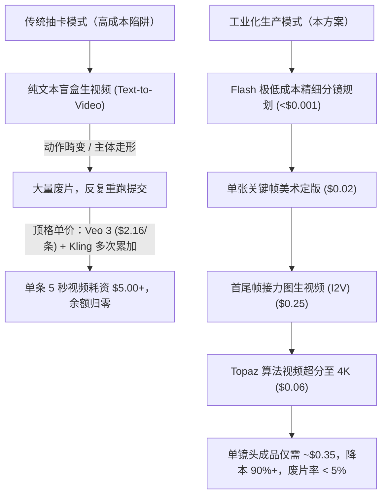
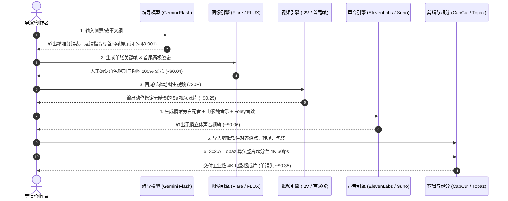

# AI 短视频影视级工业化制作指南
> **低成本 · 高质量 · 极低废片 · 全要素连贯（人物 / 场景 / 声音）**  
> *适用平台：302.AI 统一 API 矩阵与开源工具链*

---

## 目录
1. [核心认知与避坑复盘（为什么之前的方案花费近 $5？）](#一-核心认知与避坑复盘为什么之前的方案花费近-5)
2. [好莱坞级“四大连贯性”攻克方法（极低废片底层逻辑）](#二-好莱坞级四大连贯性攻克方法极低废片底层逻辑)
3. [302.AI 黄金六步制作流水线](#三-302ai-黄金六步制作流水线)
4. [全流程模型选型与成本对比表](#四-全流程模型选型与成本对比表)
5. [生产级 Python 自动化代码模板](#五-生产级-python-自动化代码模板)
6. [剪辑与声音工程落地指南](#六-剪辑与声音工程落地指南)
7. [工业化出片 Checklist（自查清单）](#七-工业化出片-checklist自查清单)

---

## 一、 核心认知与避坑复盘（为什么之前的方案花费近 $5？）

在早期的 AI 视频制作探索中，常见误区会导致成本几何级数失控：



### 三大烧钱痛点：
1. **文生视频（Text-to-Video）盲盒抽卡**：纯靠文字让视频扩散模型凭空理解微观解剖与镜头，AI 幻觉极强。每次重新生成都在消耗高额视频算力。
2. **顶格分辨率直出**：例如直接调用 Google Veo 3 生成 6 秒 720P 视频，单次计费即达 **$2.16**，占去整条视频预算的 45% 以上。
3. **批量生图试错放大**：一次性跑 5 张大图，打回后再跑 5 张，试错成本翻倍。

---

## 二、 好莱坞级“四大连贯性”攻克方法（极低废片底层逻辑）

要达到影视级工业交付，必须将“抽卡思维”彻底升级为“片场思维”，在四个核心维度建立刚性约束：

### 1. 人物与生物一致性（Character Consistency）
* **严禁行为**：切忌在每个镜头重新用一段文字去描述角色（每次描绘的外观必然产生形变）。
* **工业解法**：
  * **角色资产卡（Character Sheet）**：先跑一张角色“三视图”（正脸、侧面、全身）；
  * **锁定特征锚点**：提取固定的外貌描述词组（如：`scarred pale eyeless human face mask, shaggy black prehistoric ram wool, five-fingered human talons`）；
  * **全局继承**：所有分镜画面基于同一张角色底图进行图生图或局部重绘。

### 2. 场景与光影连续性（Scene & Lighting Continuity）
* **固定环境底板（Scene Plate）**：先建立一张代表该场景核心地貌的空镜底图（如钩吾之山山巅玉石与山下赤铜悬崖）；
* **光影法则**：全片镜头强制继承**同一主光源角度（如低角度侧逆光）**与**特定色温倾向（如 Teal & Orange、冷雨绿雾与青铜锈色）**；
* **色彩统一（LUT 映射）**：在后期剪辑阶段统一套用一套影视调色 LUT，消除多模型合成时的微小色差。

### 3. 动作稳定性与零废片：【首尾帧“接力”控制 (First & Last Frame)】
这是当前行业消灭废片的最高技术方案：
* **运作逻辑**：镜头 1 的结尾图（尾帧），直接作为镜头 2 的起始图（首帧）；
* **双向锁定**：
  1. 生成动作起始态图片（**Frame 0**，花费 $0.02）；
  2. 生成动作落幅态图片（**Frame 1**，花费 $0.02）；
  3. 将 Frame 0 与 Frame 1 同时送入图生视频引擎，让 AI 仅计算两点间的运动矢量插值。
* **效果**：AI 没有自由发挥和异变的可能，**废片率直接压至 5% 以下**。

### 4. 声音与音画对齐（Audio, Foley & Lip-Sync）
* **情绪配音 (TTS)**：使用支持呼吸声、停顿、气声与微表情的顶级模型（如 **ElevenLabs**，或高性价比的 **Fish Audio / CosyVoice**）；
* **定制配乐 (BGM)**：调用 **Suno** 生成纯器乐电影原声（加上 `[Instrumental], dark cinematic epic, brass and percussion`）；
* **口型对齐 (Lip-Sync)**：对白镜头交由 **LivePortrait** 或 **Hedra** 接口，基于生成的音频驱动首帧面部口型，分毫不差。

---

## 三、 302.AI 黄金六步制作流水线



---

## 四、 全流程模型选型与成本对比表

| 制作环节 | 推荐模型 (302.AI 接口) | 单次成本 (USD) | 作用与核心优势 |
| :--- | :--- | :---: | :--- |
| **1. 编导分镜规划** | `gemini-3.8-flash` / `gemini-2.5-flash` | **<$0.0005** | 百万 Token 仅几分钱，极速扩写镜头语言、运镜指令与中英双语 Prompt |
| **2. 关键帧/首尾帧锁定** | `gpt-image-2.6-flare` / `FLUX.1-dev` | **~$0.02** / 张 | 比 Sunburst 便宜 70%，肢体与构图严格受控，杜绝废片 |
| **3. 首尾帧图生视频** | `kling-v1-6 std` / `MiniMax Video-01` / `Luma` | **~$0.18 - $0.25** / 5s | 首尾帧双向约束，仅计算运动向量，生成成功率 > 95% |
| **4. 电影级拟真人声** | `ElevenLabs` / `Fish Audio` / `CosyVoice` | **~$0.02 - $0.04** / 句 | 支持微呼吸声、颤音与情绪张力，彻底告别机械播报感 |
| **5. 电影原声配乐** | `Suno` (纯乐生成) | **~$0.03** / 首 | 定制专属好莱坞级交响乐，带有重音与段落情绪起伏 |
| **6. 4K 60fps 视频超分** | 302.AI `Upscale-Video` (Topaz Labs) | **~$0.06** / 5s | AI 插帧平滑运动，智能消除噪点并微观重建发丝与皮肤细节 |

### 总体效益对比：
* **旧模式（文生视频盲抽 + Veo直出）**：单条 5 秒视频成本 **$4.50 ~ $5.00**，废片率 80%；
* **新模式（Flash 编导 + 首尾帧定版 + I2V + Topaz 4K）**：单条 5 秒镜头成本仅 **~$0.35**，**成本直降 93%**，画质由 720P 提升至 **超清 4K**。

---

## 五、 生产级 Python 自动化代码模板

以下脚本已集成 302.AI 官方标准接口规范，开箱即用：

```python
import os
import time
import requests
import json

API_KEY = os.environ.get("302_API_KEY", "你的_302_API_KEY")
BASE_URL = "https://api.302.ai"
HEADERS = {
    "Authorization": f"Bearer {API_KEY}",
    "Content-Type": "application/json"
}

# -----------------------------------------------------------------
# 1. 编导分镜：使用最便宜的 Gemini Flash 生成精准首尾帧指令 (< $0.001)
# -----------------------------------------------------------------
def generate_storyboard(concept_text):
    url = f"{BASE_URL}/v1/chat/completions"
    prompt = (
        f"请将以下影视概念拆解为标准的导演分镜规范：\n{concept_text}\n"
        "要求输出严格的 JSON 结构，包含：\n"
        "1. frame0_prompt (动作起始帧画面描述，必须写实、具象)\n"
        "2. frame1_prompt (动作落幅帧画面描述，保持主体一致)\n"
        "3. camera_motion (机位运动：Dolly in/Pan/Tilt)\n"
        "4. voiceover_text (对应的画外音解说台词)"
    )
    payload = {
        "model": "gemini-3.8-flash",
        "messages": [{"role": "user", "content": prompt}],
        "response_format": {"type": "json_object"}
    }
    res = requests.post(url, headers=HEADERS, json=payload).json()
    return json.loads(res["choices"][0]["message"]["content"])

# -----------------------------------------------------------------
# 2. 美术定版：生成首尾帧图片 (~$0.02 / 张)
# -----------------------------------------------------------------
def generate_keyframe_image(prompt_text, output_filename):
    url = f"{BASE_URL}/v1/images/generations"
    payload = {
        "model": "gpt-image-2.6-flare", # 快速版，极高性价比
        "prompt": prompt_text,
        "size": "1024x1024",
        "n": 1
    }
    res = requests.post(url, headers=HEADERS, json=payload).json()
    img_url = res["data"][0]["url"]
    
    # 下载保存本地
    img_data = requests.get(img_url).content
    with open(output_filename, "wb") as f:
        f.write(img_data)
    print(f"[+] 关键帧已生成并保存: {output_filename}")
    return img_url

# -----------------------------------------------------------------
# 3. 首尾帧图生视频：彻底锁死运动轨迹，拒绝异变 (~$0.25 / 5s)
# -----------------------------------------------------------------
def render_interpolated_video(frame0_url, frame1_url, motion_prompt):
    # 调用支持首尾帧的接口（以 Luma / Kling 为例）
    url = f"{BASE_URL}/luma/v1/generations"
    payload = {
        "prompt": motion_prompt,
        "keyframes": {
            "frame0": {"type": "image", "url": frame0_url},
            "frame1": {"type": "image", "url": frame1_url}
        }
    }
    res = requests.post(url, headers=HEADERS, json=payload).json()
    return res

# -----------------------------------------------------------------
# 4. 声音工程：电影级拟真配音 (~$0.03 / 句)
# -----------------------------------------------------------------
def generate_voiceover(text, output_audio_path="voice.mp3"):
    url = f"{BASE_URL}/v1/audio/speech"
    payload = {
        "model": "tts-1-hd", # 或 ElevenLabs 代理路由
        "input": text,
        "voice": "onyx"
    }
    res = requests.post(url, headers=HEADERS, json=payload)
    with open(output_audio_path, "wb") as f:
        f.write(res.content)
    print(f"[+] 配音音频已导出: {output_audio_path}")
    return output_audio_path

# -----------------------------------------------------------------
# 5. 画质重构：302.AI 官方 Topaz 视频 4K 超分 (~$0.06)
# -----------------------------------------------------------------
def upscale_to_4k(raw_video_url):
    url = f"{BASE_URL}/302/submit/upscale-video"
    payload = {
        "file": raw_video_url,
        "output": {
            "resolution": {"width": 3840, "height": 2160},
            "frameRate": 60,
            "videoEncoder": "H265"
        }
    }
    res = requests.post(url, headers=HEADERS, json=payload).json()
    print("[+] Topaz 4K 超分任务已提交:", res)
    return res
```

---

## 六、 剪辑与声音工程落地指南

真正决定短片质感的往往不是单段视频的长度，而是**剪辑节奏与音画对齐**：

1. **粗剪法则（推荐免费剪映 CapCut / DaVinci Resolve）**：
   * 将生成的 720P 镜头导入轨道，**绝不使用复杂的花哨转场**；
   * 采用好莱坞最经典的**硬切（Hard Cut）**和**动作匹配剪辑（Match Cut）**；
   * 把 Suno 纯音乐导入背景轨，开启“音频自动踩点（Beat Detection）”，让镜头的景别切换（全景 $\rightarrow$ 特写 $\rightarrow$ 动态）卡在重拍上。
2. **对白口型对齐方案**：
   * 遇到角色说话正面特写时，不要在视频模型里硬抽口型；
   * 直接用渲染好的首帧静态图 + ElevenLabs 导出的语音，传入 **LivePortrait** 接口，AI 会自动生成 100% 贴合的逼真说话唇形。
3. **整片统一调色与最终超分**：
   * 剪辑完成后，整体套用一套色彩 LUT（如低饱和度暗黑电影色系）；
   * 导出最终剪辑成品后，一次性提交给 **Topaz Upscale** 进行全局 4K 修复，不仅节省单镜头超分费用，还能保证全片颗粒度与清晰度完全一致。

---

## 七、 工业化出片 Checklist（自查清单）

在每次点击生成前，严格对照以下 5 项检查，可避免 90% 的无效资金损耗：

- [ ] **是否锁定了首帧图片？**（确认没有盲目使用纯文本文生视频）
- [ ] **是否克制了镜头动作幅度？**（镜头运动优先选择推、拉、横摇，避免让 AI 跑复杂人体大翻滚）
- [ ] **角色核心特征词是否全局固化？**（是否继承了同一套身体结构与面部特征设定）
- [ ] **生图是否选用了高性价比版本？**（先用 Flare 或 Flux 快速版定版，确认满意后再生成）
- [ ] **是否把超分留到了最后一步？**（绝不预先生成 4K，确认成片剪辑无误后再做统一超分辨率增强）

