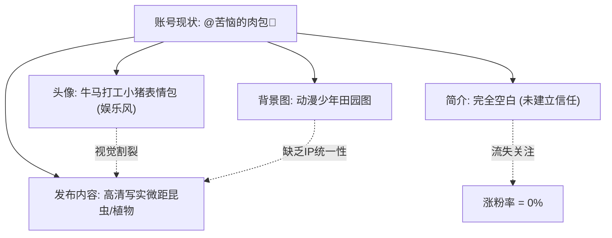
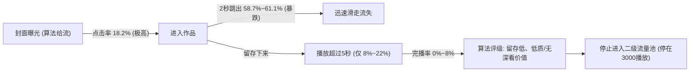
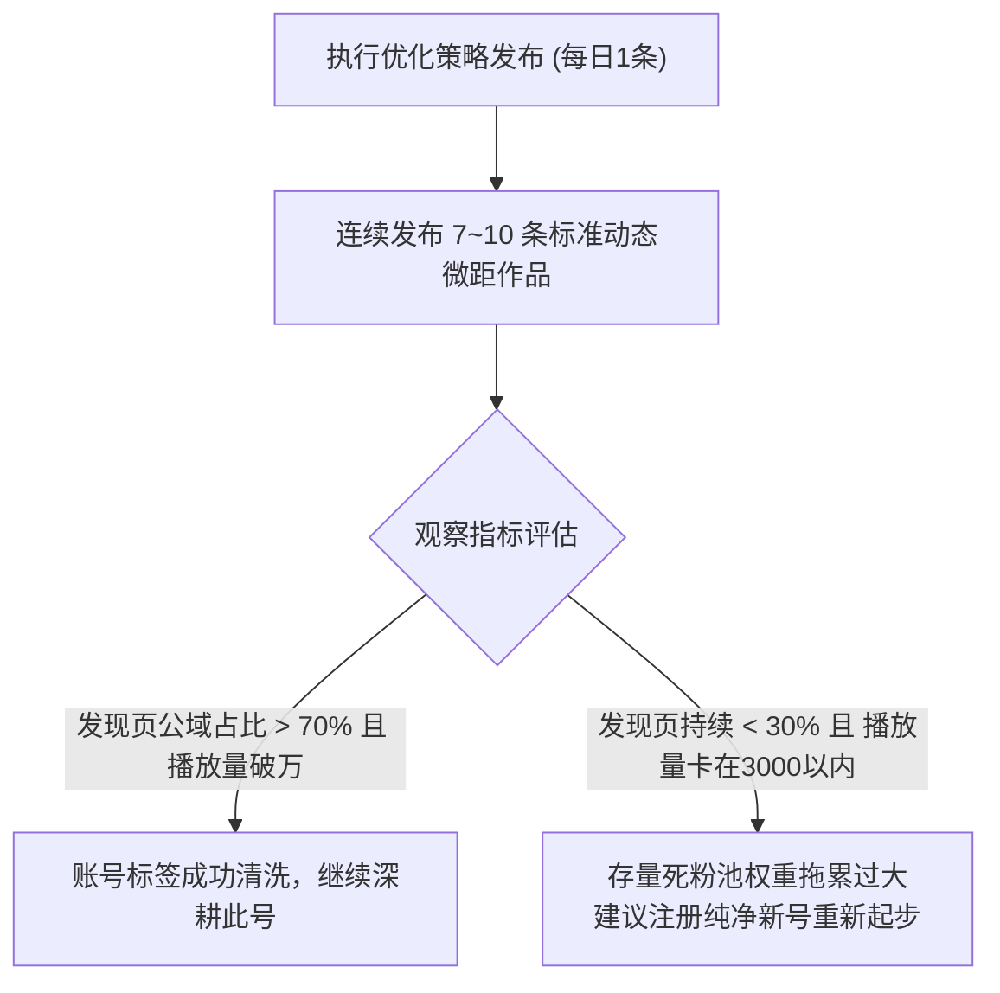

# 快手账号数据分析与运营诊断报告

**报告日期**：2026-11-14  
**诊断账号**：@苦恼的肉包🍔（快手号：zhuangfanxin10）  
**赛道品类**：自然风光 / 动植物微距摄影 / 生活记录  
**数据来源**：快手创作者服务中心（截取时间：2026-11-14 17:26~17:41）  
**分析样本**：账号全部 2 条已发布公开作品及粉丝画像、流量来源大盘数据  

---

## 目录
1. [诊断核心结论摘要](#一诊断核心结论摘要)
2. [数据源与样本清单](#二数据源与样本清单)
3. [账号基本盘与视觉包装诊断](#三账号基本盘与视觉包装诊断)
4. [作品流量漏斗与行为深度分析](#四作品流量漏斗与行为深度分析)
5. [受众画像与粉丝池污染分析](#五受众画像与粉丝池污染分析)
6. [核心症结归因矩阵](#六核心症结归因矩阵)
7. [破局优化与落地执行方案 (SOP)](#七破局优化与落地执行方案-sop)
8. [后续追踪指标与复盘节点](#八后续追踪指标与复盘节点)

---

## 一、诊断核心结论摘要

> **核心定论**：账号**未受任何限流或降权处罚**，反而拥有极好的初始视觉辨识度。当前流量低迷的本质并非算法不推流，而是**“高吸引力封面”与“极低停留交付”之间形成了断层**，触发了算法熔断机制。

* **亮点与优势**：
  * **封面点击率表现卓越**：最高达 **18.2%**（蜜蜂微距），次高达 **11.1%**（绿叶雨滴），显著高于行业平均及格线（8%~12%），证明摄影审美与微距细节在公域中有极强的路人吸睛能力。
  * **初始流量池给足了测试额度**：新号前两篇作品分别获得 **3,813** 和 **2,650** 次曝光，快手对该账号的自然分发态度积极。
* **致命短板**：
  * **2秒跳出率过高**：两篇分别达到 **58.7%** 与 **61.1%**，接近 6 成观众点进后瞬间滑走。
  * **完播率濒临归零**：蜜蜂长图完播率为 **0%**，平均播放仅 **2.5秒**。
  * **互动率极度疲软**：两千多至三千多播放下，仅收获 8~11 个赞、0~1 条评论，**互动率仅约 0.3%**（健康水平应在 3%~5% 以上）。
  * **存量粉丝严重不活跃**：1515 个粉丝中，**67.1% 活跃时长为 0**，以 12~17 岁学生（36.2%）和女性（71.5%）为主，与动植物摄影严重错位。

---

## 二、数据源与样本清单

本报告基于 `C:\Users\33046\Desktop\short video\kuaishou\data analyzed\2026-11-14` 目录下的 15 份原始截图进行交叉校验：

| 文件名 | 内容分类 | 关键信息点 |
| :--- | :--- | :--- |
| `de32b5306b4ad4995d1cc29f422e949d.jpg` | 个人主页概览 | 粉丝 1515、关注 125、获赞 19、作品 2 条、简介空白 |
| `1dc0c637d6aedd990870c89b489b7b5c.jpg` | 作品 1 详情 (蜜蜂) | 长图形式、3813 浏览、11 赞、1 评、0 藏、0 转 |
| `1e8aeb77ae85dcd0a85cda6051fafd97.jpg` | 作品 1 流量分析 | 点击率 18.2%、2秒跳出 58.7%、5秒完播 8.3%、完播率 0% |
| `4edf3eeffbcb44686c21f3c829ce8b8d.jpg` | 作品 1 雷达图 | 封面吸引力强，观众互动极低，开头吸引力弱 |
| `8641f4c8fd346e22e83a85775ad40e77.jpg` | 作品 2 详情 (绿叶) | 动图形式、2751 浏览、9 赞、0 评、0 藏、0 转 |
| `2928c03fcaf3f257ab9f1efb6bba5be1.jpg` | 作品 2 流量分析 | 点击率 11.1%、2秒跳出 61.1%、5秒完播 22.2%、完播率 8.3% |
| `c13502b69dde8b570d012d0e2bb99d72.jpg` | 作品 2 雷达图 | 流量持续获得中，互动率仅 0.3%，涨粉 0 |
| `e7a3d49fe02ee19c137a2a1d5ce1912d.jpg` | 创作者后台作品列表 | 近 90 天仅发布此 2 条作品 |
| `5be80888e269f24c3cb6b3d97409247e.jpg` | 流量来源构成 | 主页 49.8%、精选 16.6%、发现 16.6%、关注 13.3% |
| `6b6c223bb5e7ba375d992b3181064ed1.jpg` | 账号综合诊断 | 投稿量与评论量低于 90% 同类，播放量超过 57.2% 同类 |
| `073767c3cc7f8199298051a6c3cae98e.jpg` | 粉丝画像大盘 | 女 71.5%、男 28.5%、12-17 岁占 36.2% |
| `b9f61d08388d40150e3bc38c43c4a52a.jpg` | 粉丝年龄细分 | 12-17 岁为主力，>=50 岁占 14.9% |
| `73aaaa99f48f61d9c7d2b1cf23b448a6.jpg` | 粉丝地域分布 | 广西 9.5%、广东 9.3%、河南 8.5%、山西 8.1% |
| `9a190db59e03caeeba9b1b81c661d951.jpg` | 粉丝兴趣分布 | 运动 37.6%、影视、随手拍、游戏 |
| `9f1a340a7fbc9f190d8298c559e1fee7.jpg` | 粉丝活跃时段与时长 | 未知时段占 61.9%，**活跃时长为 0 占 67.1%** |

---

## 三、账号基本盘与视觉包装诊断



### 1. 元素割裂分析
* **昵称**：`苦恼的肉包🍔` —— 偏向日常泛娱乐/随想昵称，完全无法向公域用户传递“摄影/微观世界/植物/自然”的价值主张。
* **头像**：头扎“牛马”头巾、在电脑前加班的卡通小猪表情包 —— 强烈表达出打工人自嘲情绪，但与作品中极具质感、唯美治愈的动植物自然微距大片产生严重**心理落差**。
* **个人简介**：显示“点击添加介绍，让大家了解你”，**处于未填写状态**。路人即使觉得图好看点进主页，也不知道关注这个博主能获得什么。
* **背景图**：日漫田园风插画，风格与头像、内容三者均不统一。

---

## 四、作品流量漏斗与行为深度分析

### 1. 两篇典型作品数据对比

| 监测指标 | 作品 1 (蜜蜂微距长图) | 作品 2 (绿叶水滴动图) | 健康参考基准 |
| :--- | :--- | :--- | :--- |
| **发布时间** | 2026-11-13 22:53 | 2026-11-14 10:02 | — |
| **内容形态** | 静态长图 | 动图 (实拍短片段) | 微视频 / 多图卡片 |
| **播放总量** | **3,813** | **2,650** (持续中) | 基础池 (500~3000) |
| **封面点击率** | **18.2%** | **11.1%** | 8% ~ 12% |
| **平均播放时长** | **2.5 秒** | **4.8 秒** | 需 > 5~8 秒 |
| **2秒跳出率** | **58.7%** | **61.1%** | 需 < 30% |
| **5秒完播率** | **8.3%** | **22.2%** | 需 > 35% |
| **最终完播率** | **0.0%** | **8.3%** | 需 > 15%~25% |
| **点赞数** | 11 | 8~9 | 点赞率需 > 3% |
| **评论数** | 1 | 0 | 评论率需 > 0.5% |
| **互动转化率** | **0.31%** | **0.34%** | **严重偏低** |
| **涨粉转化** | 0 人 | 0 人 | — |

### 2. 流量漏斗瓶颈拆解


* **结论**：
  1. **作品 1（蜜蜂）**：封面点击率虽然极高（18.2%），但在静态长图呈现下，观众滑开一秒即看完整体，**0% 的完播率与 2.5 秒的平均时长**直接终结了后续爆发可能。
  2. **作品 2（动图）**：由于具备微动画面，5秒完播率提升到了 22.2%，平均时长增加到了 4.8 秒，说明**动态画面显著优于纯静态长图**，但因为缺少前置冲突或故事钩子，2秒跳出率依旧高达 61.1%。

---

## 五、受众画像与粉丝池污染分析

### 1. 核心矛盾：粉丝标签与自然摄影定位严重背离

```text
当前账号存量粉丝 (1515 人)
├── 性别：女性 (71.5%)、男性 (28.5%)
├── 年龄：12~17 岁青少年 (36.2%)、18~23 岁 (23%)、≥50 岁 (14.9%)
├── 兴趣关注：运动 (37.6%)、商品售卖、影视、游戏
└── 活跃度：活跃时长为 0 占 67.1%，未知活跃时段占 61.9%
```

### 2. 粉丝池对算法测试的影响机制
1. **死粉占比过高**：获赞总数仅 19，粉丝却有 1515，且近 7 成粉丝活跃时长为 0。极大概率是**早期非垂直内容遗留、互关互粉或低质营销粉**。
2. **种子测试失真**：快手新发布作品后，算法会先抽样下发至部分已关注粉丝和初级兴趣池。由于现有粉丝基本不活跃，甚至兴趣是“初中生/运动/网购”，他们对动植物微距没有点击和完播动作，给算法模型返回了极其负面的**“老粉都不买账”**信号。
3. **主页来源畸高**：近 7 天流量来源中，**个人主页占了 49.8%**，公域“发现页”仅占 16.6%。这证明作品基本依靠外部引导或个人主页反复查看，公域大盘的自然撬动受阻。

---

## 六、核心症结归因矩阵

| 症结编号 | 核心问题 | 现场证据 | 算法惩罚后果 |
| :---: | :--- | :--- | :--- |
| **01** | **内容缺乏交付深度** | 纯静态长图、无解说、无声音驱动 | 2秒跳出率达 60%，完播率断崖 |
| **02** | **文案与互动钩子缺失** | “生活～ #自然风光” 等抒情散句 | 评论仅 0~1 条，互动率仅 0.3% |
| **03** | **账号定位与人设断层** | 牛马小猪头像 + 苦恼的肉包 + 简介空白 | 用户点进主页无法建立认知，转粉率为 0 |
| **04** | **存量受众与内容冲突** | 1515 存量粉 70% 僵尸，主力为学生妹 | 初始推送数据被死粉拉垮 |
| **05** | **发布样本极低** | 90天仅发 2 篇，处于冷启动初试期 | 系统未沉淀出精准的推荐标签 |

---

## 七、破局优化与落地执行方案 (SOP)

### 步骤一：重塑主页人设四件套（打造专业/治愈IP）

* **昵称调整**（三选一）：
  * `肉包的微距视界`（突出微距摄影专业感）
  * `肉包微观日记`（突出生活记录、治愈陪伴感）
  * `肉包与自然生灵`（突出动植物、生态关怀）
* **头像更换**：
  * 舍弃“加班牛马猪”表情包。
  * 换用**亲手拍摄的高清黄金蜜蜂微距特写**，或**手持微距镜头在绿植中的摄影师侧影/剪影**。
* **背景图**：
  * 更换为高清晰度的微距植物水滴摄影作品，保持整体色调（纯净绿/自然阳光）统一。
* **个人简介规范模版**：
  ```text
  📍 坐标深圳｜用微距镜头记录身边被忽略的微观世界 🌿
  一花一草一生灵，带你看肉眼看不到的自然奇迹 📸
  每日更新大自然的治愈瞬间，老铁们喜欢哪种植物/小虫欢迎留言！
  ```

---

### 步骤二：内容形态技术升级（告别纯静态长图）

要攻克“2秒跳出率”和“完播率”，必须将素材由**“静态陈列”**改为**“动态探索”**：

#### 方案 A：多图卡片轮播（适合依然想发图文的场景）
* **第 1 张（黄金钩子）**：极致微距局部特写（不露出全貌），居中添加悬念大字。例如：*“在小区绿化带趴了40分钟，拍到这个‘金毛小怪’到底是什么？”*
* **第 2~3 张（细节递进）**：逐步拉开焦距，展示翅膀透明脉络、花粉囊特写。
* **第 4 张（揭开真相 + 知识增量）**：展示蜜蜂采蜜全貌，配文介绍：*“它腿上的小黄球，其实是揉搓好的花粉团，只有勤劳的工蜂才有！”*

#### 方案 B：微视频化合成（强烈推荐，获取最高推流权重）
* **画面动感**：使用剪映/快影，将高清微距原图添加 **“缓慢推拉变焦（Zoom-in/Zoom-out）”** 或轻微平移动态，模拟摄像机航拍微观森林的视角。
* **音效沉浸**：
  * **音轨 1（环境白噪音）**：清脆雨滴声、微风拂过叶片沙沙声、轻微虫鸣。
  * **音轨 2（BGM）**：舒缓治愈、轻快明朗的纯音乐（避开烂大街的重低音爆款神曲）。
  * **前 3 秒音画同频**：前 3 秒画面微颤 + 清脆水滴音效，迅速抓住注意力，把 2 秒留存拉升至 70% 以上。

---

### 步骤三：文案与评论区互动引爆设计

#### 1. 标题与文案撰写公式
$$\text{吸引眼球的前置情境} + \text{痛点/趣味细节} + \text{评论区互动疑问}$$

* **原方案（低转化）**：
  > “生活～ #自然风光 #记录美好瞬间 #摄影爱好者”
* **改写示范（高互动）**：
  > “在公司楼下花坛趴了半个小时，工友以为我丢了钥匙，其实我在等这只‘金毛采蜜工’抬头！📸 腿上装满两颗大花粉球，看着都替它觉得沉。  
  > 考考眼力好的老铁：有人认得出它采的是什么花吗？在评论区等民间植物大师👇”  
  > `#微距摄影 #治愈系自然 #身边的微观世界 #大自然有多神奇`

#### 2. “自评置顶”互动法（拉升 0.3% 互动率的实操技巧）
作品刚发出的前 5 分钟内，博主必须**用大号抢占第一条评论并置顶**：
* *置顶示范*：“图 3 的水珠折射出了整棵树的倒影，建议双击放大看细节！大家小时候抓过这种蜜蜂的扣个 1，被蜇过的老铁扣个 2 让我安慰一下😂”
* 观众看到置顶评论后，回复门槛从“写小作文”降低为“扣 1 或 2”，互动率可瞬间提升 5~10 倍。

---

### 步骤四：关于 1515 个存量粉丝的处理策略

建议采取**“两阶段观察法”**，避免盲目放弃或盲目硬刚：



1. **第一阶段（试金石测试：7~10 天）**：
   * 按照上述主页包装 + 微动视频 + 互动文案，**每天在 12:00~13:00 或 18:30~20:00 稳定发布 1 条**（避开深夜 23 点发布）。
   * 观察公域发现页推荐比例是否从 16.6% 恢复至 60% 以上。
2. **第二阶段（洗粉 vs 换号决策）**：
   * 如果 10 天后作品平均播放突破 5,000~10,000，完播率稳定在 20% 以上，说明公域推流成功穿透了死粉池，继续维持。
   * 如果数据依然严重停滞、新关注寥寥无几，说明 1500 粉丝的负反馈权重在算法底层根深蒂固，此时**直接启用一个新手机号注册纯净账号**，将同一批高质量素材按新模式重新发布，通常新号能以更快的速度进入公域高速池。

---

## 八、后续追踪指标与复盘节点

建议博主在执行优化后，以 **7 天为周期** 记录以下核心数据指标的变化：

```text
复盘追踪仪表盘 (周度记录)
│
├── [ ] 封面点击率：维持在 12%~18% 高位区间
├── [ ] 2秒跳出率：从当前 60% 压降至 35% 以下
├── [ ] 5秒完播率：从当前 8%~22% 提升至 40% 以上
├── [ ] 整体互动率：(赞+评+藏+转)/播放量 从 0.3% 提升至 3.0% 以上
├── [ ] 流量结构：公域“发现页/精选页”合计占比从 33% 提升至 70% 以上
└── [ ] 主页转化：单篇作品涨粉量实现从 0 到 10+ 的突破
```

---
*报告生成路径：`C:\Users\33046\Desktop\short video\kuaishou\data analyzed\2026-11-14\2026-11-14_快手账号数据分析与运营诊断报告.md`*
